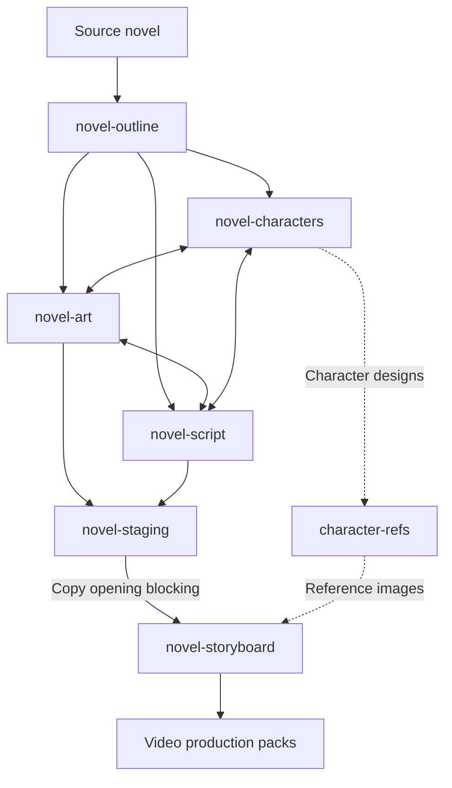
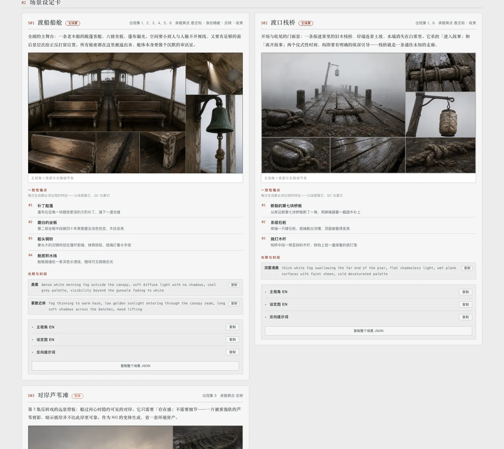
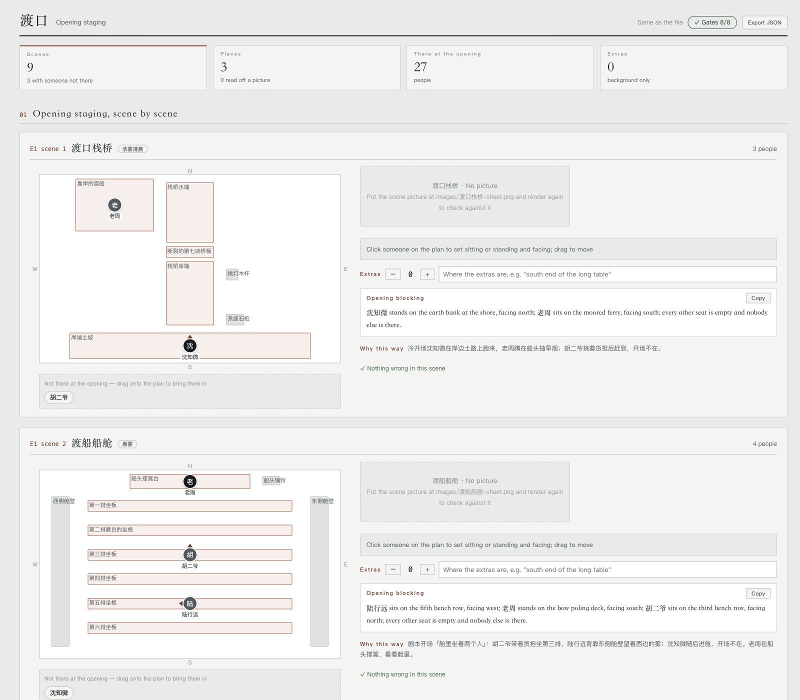
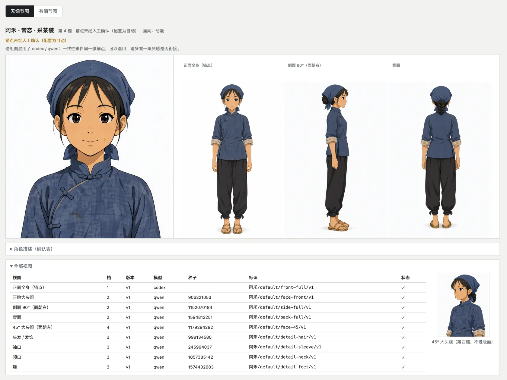

[](README.zh.md)
[](README.md)

# shuohao-skills

**Agent-agnostic skills for AI short-drama production** — from a novel to shoot-ready material: character bibles, adaptation outlines, scene & prop bibles, screenplays, opening staging, and storyboards. Each skill is self-contained and works with any Agent that can read `SKILL.md` and run the bundled scripts; Claude Code and Codex are two supported examples, not requirements.

The repository now contains **seven skills: six production stages plus standalone character reference generation**. The outline settles the adaptation; characters, art, and screenplay iterate together; staging fixes each scene's opening positions before storyboarding.



| Skill | What it does |
| --- | --- |
| [**novel-outline**](skills/novel-outline/README.en.md) | Adapts a novel into a five-piece short-drama outline: adaptation notes, cast, beats, per-episode synopses, asset list (including a narrative-prop table). All 14 quality gates are script-checked; includes a checkup mode for existing outlines |
| [**novel-characters**](skills/novel-characters/README.en.md) | Turns the cast the outline settled on into a character bible: profiles, design prompts, voice prompts, model sheets. Seeds the roster from outline.json; report language is configurable |
| [**character-refs**](skills/character-refs/README.en.md) | **Actually generates** reference images for characters from any story (not just novels — your own original story works too): describe a character in one message; it is split into fields, gaps filled and confirmed, then a front full-body anchor is generated and every other view (headshot, 90° profile, back, details) references only that anchor, in on-demand tiers. Every image is labeled and individually regenerable, with staleness tracked. Works with Qwen Image (ComfyUI), codex image generation, the GPT Image 2 API, or a custom command |
| [**novel-art**](skills/novel-art/README.en.md) | Art bibles for AI production (scenes + narrative props): consistency anchors, lighting & state variants, scale references, no-people/no-hands white plates. Seeds from outline.json; all 10 quality gates script-checked |
| [**novel-script**](skills/novel-script/README.en.md) | Screenwriting for AI short drama: scenes + beat flow (action beats alternating with dialogue lines), per-episode duration deterministically estimated from reading speed, a gated cold-open hook in the first 3 beats, a per-character line book with voice prompts that feeds straight into TTS. All 10 quality gates script-checked |
| [**novel-staging**](skills/novel-staging/README.en.md) | Plans opening positions from the screenplay and scene images: each character’s seat or standing position, facing direction, opening presence, and extras. Produces staging.json, an editable top-view report, and opening blocking sentences for the storyboard. All 8 quality gates script-checked |
| [**novel-storyboard**](skills/novel-storyboard/README.en.md) | Storyboarding for AI short drama: segments (one generation, ≤15s) → cuts (2–5s hard gate) → keyframes (master pinned at 0.00s, sub-frames at their cut marks), with MiniMax H3 prompt alignment and cut times audited verbatim; frames actually generated with the design sheets as references, plus one-command H3 / Seedance production packs. All 18 quality gates script-checked |

**All six pipeline skills render their reports in English too** — reports default to a Chinese UI; pass `--lang en` to `render` for a fully English report (data content stays as authored). character-refs ships Chinese, English and Japanese UIs too, and translates on the spot for other languages.

## Scene Staging: inputs, outputs, and handoff

`novel-staging` runs after the screenplay and before the storyboard. It reads `script.json` for scenes and cast; `art.json` supplies locations, `outline.json` supplies character names, and scene images show the objects people can stand beside or sit on. The screenplay is required; the other inputs improve the result. Without scene images, positions inferred from the art specification are marked provisional. These files can come from any producer; no other skill installation is required.

| Output | What it provides |
| --- | --- |
| `staging.json` | Opening presence, anchor object, side, position, posture, facing, and extras for every scene |
| `staging.md` (optional) | Text export with inventories, position tables, and opening blocking sentences |
| **`staging-report.html` (default)** | Interactive tool report with a draggable top view and live checks; export edits back to JSON |
| `blocking` command output | One opening blocking sentence per scene, ready to copy into its first storyboard segment |

An Agent reads the scene images and plans the staging; the bundled Node.js tools seed the data, check the eight gates, render reports, and generate the blocking sentences. The HTML tool report is the default user-facing result and opens locally in a browser. JSON is working data; Markdown is generated only on request. To try the completed sample from the repository root:

```bash
node skills/novel-staging/scripts/novel-staging.mjs validate skills/novel-staging/examples/渡口-staging.json --script skills/novel-staging/references/test-fixtures/upstream/渡口-script.json --art skills/novel-staging/references/test-fixtures/upstream/渡口-art.json
node skills/novel-staging/scripts/novel-staging.mjs render skills/novel-staging/examples/渡口-staging.json --lang en > staging-report.html
node skills/novel-staging/scripts/novel-staging.mjs blocking skills/novel-staging/examples/渡口-staging.json --lang en
```

**The storyboard does not automatically import `staging.json` yet.** Give the Agent the accepted opening blocking sentences and ask it to copy each one into the first segment of its scene. This stage outputs staging data and reports; it does not generate images or video. See the [skill guide](skills/novel-staging/README.en.md) for authoring a new staging plan.

## One page for five stage reports

The assembler currently supports **outline, characters, art, screenplay, and storyboard**. It does not include the staging report or character-refs gallery. These five supported reports can be merged into a single page with a left-hand nav — **you get a pane for every supported stage you actually have**:

```bash
node scripts/report.mjs --from <demo-dir> --out report.html
```

`--from` discovers the five json files using the [working-directory convention](#repository-conventions); you can also point at each one directly (`--outline` `--cast` `--art` `--script` `--storyboard`). Ran only the character pass? You get one pane, no error.

It is an **assembler, not a separate skill**: it imports no skill code, it shells out to each skill's own `render --html` and stitches the results. So the five skills stay untouched, still run standalone, and are still copyable on their own — and when a skill changes its rendering, this picks it up for free.

Merging solves three problems, **all of them inside the assembler, none inside the skills**:

- **Style bleed.** The five reports share 57 class names, 13 of which mean different things in different reports (`.copy`, `.kpis`, `.badge`, `.chip`…), so every selector gets a scope prefix
- **Script bleed.** Each report's script does document-wide lookups like `document.querySelector('.expo')`. Merged, that only ever finds the first one — all five export buttons would break. Each script gets wrapped in a scoping proxy
- **Asset paths.** Each report's images are relative to its own json directory (`images/…`, `E01-01/f1.png`) and get rebased against the output file

One pane shows at a time by default (the five together run to roughly 600k characters). "Show all" in the bottom-left expands every pane so Cmd+F reaches the whole document. Number keys `1`–`5` switch panes, and `#pane-script` deep-links straight to one.

```bash
node scripts/report-selftest.mjs   # 92 assertions, no browser needed
```

Reports from the six production stages:

**novel-outline · short-drama adaptation outline**


**novel-characters · character bible**


**novel-art · art bible (scenes + props, sheets actually generated by the skill)**



**novel-script · screenplay (duration gauge + episode scripts + line book)**


**novel-staging · opening staging (a top view you drag people on, then export)**



**novel-storyboard · storyboard (cut rhythm strip + master/sub keyframes actually generated by the skill + H3 prompts)**


No novel needed for this one — real reference images for any character:

**character-refs · character references (anchor by GPT, the rest by Qwen, all actually generated by the skill)**



## Install

```bash
git clone https://github.com/eternityspring/shuohao-skills.git
cd shuohao-skills
./scripts/install.sh
```

The installer currently detects Claude Code and Codex and **symlinks** every skill into place — so `git pull` takes effect immediately, with no reinstall. The skills themselves are not tied to either runtime. For any other Agent, copy or symlink the skill directory into its skills directory, or load its `SKILL.md` directly.

```bash
./scripts/install.sh novel-characters   # just one skill
./scripts/install.sh --codex            # only into codex
./scripts/install.sh --uninstall        # remove the symlinks
```

Prefer to do it by hand:

```bash
AGENT_SKILLS_DIR=/path/to/your-agent/skills
ln -s "$PWD/skills/novel-characters" "$AGENT_SKILLS_DIR/novel-characters"
ln -s "$PWD/skills/novel-characters" ~/.claude/skills/novel-characters
ln -s "$PWD/skills/novel-characters" ~/.codex/skills/novel-characters
```

## Without Codex: the Python agent (zhipu_agent)

No Codex or Claude Code quota? Use `zhipu_agent/`: Python plus any OpenAI-compatible LLM API (Zhipu or an aggregator) drives the seven skills in order. The skills are unchanged: the model reads each skill's `references/*-pass.md` and `schema.md` as instructions, and the skills' own Node scripts (`validate`, `merge`, `assemble`, `render`, …) act as quality gates. When validation fails, each violation is routed to the episode, scene or character it names, and only those items are regenerated with the error attached.

> Status: offline tests (fake model + the real validators) pass the six stages on the bundled sample. Real-model writing quality, how many repair rounds are needed, the vision-model image format and real image generation are **not yet verified** — start with a short text and `--eps`.

### Setup

```bash
git clone -b master https://github.com/andnls100/shuohao-python-agen.git
cd shuohao-python-agen
pip install -r requirements.txt        # only the openai package
node --version                         # Node 18+
cp .env.example .env                   # Windows: copy .env.example .env
```

Fill at least these in `.env`:

```
ZHIPU_API_KEY=your-key
ZHIPU_MODEL=model-name
ZHIPU_BASE_URL=https://open.bigmodel.cn/api/paas/v4/
```

For an aggregator, set `ZHIPU_BASE_URL` to its OpenAI-compatible endpoint and use its model names. `.env` is git-ignored.

### Multiple models and platforms (a pool)

With one platform and one model, `.env` is enough. For several text models, several vision models, each with its own address and key (like an account pool), copy `models.example.json` to `models.json` and fill it in. It is git-ignored; when it exists, the model/address/key variables in `.env` are no longer used (other options such as concurrency still come from `.env`).

```json
{
  "strategy": "failover",
  "cooldown": 120,
  "text":   [ { "name": "p1", "base_url": "https://…/v1", "api_key": "…", "model": "…" },
              { "name": "p2", "base_url": "https://…/v1", "api_key_env": "P2_KEY", "model": "…" } ],
  "vision": [ { "name": "v1", "base_url": "https://…/v1", "api_key": "…", "model": "…" } ]
}
```

- `text` serves all text generation; `vision` is used only when staging reads scene images (omit it or use `[]` if you do not need it).
- Each entry has its own `base_url`, `api_key` (or `api_key_env` to read it from an environment variable) and `model`; optional `temperature`, `max_tokens`, `timeout`, `stream`, `json_mode` apply to that entry only. `name` must be unique within a list.
- `failover` (default): use entries in order, the next one only when the previous fails. `round_robin`: each call starts from the next entry, spreading concurrent calls across platforms.
- When a platform fails, the agent retries briefly, then moves to the next one; the failed platform goes to the back of the line for `cooldown` seconds (five times as long for 401/402/403). If every platform fails, the error lists each one's reason.
- Without a file, a vision model on a different platform can be set with `ZHIPU_VISION_BASE_URL` and `ZHIPU_VISION_API_KEY` in `.env`; unset, it shares the text model's platform.
- `python run_agent.py doctor --ping` calls every entry once and shows which work.

### Run

The entry point is `run_agent.py` (same as `python -m zhipu_agent.main`; use it if `-m` cannot find the package, e.g. when Python runs in isolated mode):

```bash
python run_agent.py doctor --ping      # check the environment and make one real model call
python run_agent.py run --book input/novel.txt --episodes 6 --minutes 2 --genre urban
python run_agent.py status             # which stages exist and pass validation
```

Put the novel at `input/novel.txt` (UTF-8 or GBK). Outputs go to `output/`, with a `*-report.html` per stage.

### Stages and common commands

Stages: `outline` → `characters` → `art` → `script` → `staging` → `storyboard`, plus the optional `refs` (character-refs, not run by default). Finished stages that pass validation are skipped.

```bash
python run_agent.py run --stages outline --book input/novel.txt --episodes 6 --minutes 2 --genre urban
python run_agent.py run --stages characters,art
python run_agent.py run --stages script,staging,storyboard --eps 1-2     # small trial first
python run_agent.py run --stages storyboard --aspect 9:16 --prompt-lang zh
python run_agent.py run --stages refs --refs-names Alice --refs-gen      # --refs-gen needs an image model configured
python run_agent.py run --yes ...                                        # no pause at the outline checkpoint
python run_agent.py run --stages script --force                          # ignore existing output and cache
```

`--genre` is **free text — there is no fixed list**; the skill only requires it to be present. It decides which hook types (face-slaps, reveals, reversals…) the outline is built around, so be specific: it is written as audience/setting plus the core appeal, e.g. `Republic-era romance mystery` (the bundled sample), `female-lead revenge` (the schema example), `urban medical comeback`.

Other options: `--out`, `--adapt-mode`, `--images` (scene images, needs a vision model), `--concurrency` (default 3), `--fix-rounds` (default 3).

### Output files per step

Everything goes under `--out` (default `output/`), one sub-folder per stage. In the names below, `<title>` is inferred from the novel. **Each stage's main file is the `.json`**, which later stages read; the `.md` and `.html` files are rendered from it for reading.

| Step | Stage | Main file | For reading | Intermediate files (cache, for resume) |
| --- | --- | --- | --- | --- |
| 1 | `outline` | `outline/<title>-outline.json` — adaptation, cast table, hook table, episode synopses, asset list | `<title>-outline.md`, `outline-report.html` | `work/outline/eps-*.json` |
| 2 | `characters` | `characters/<title>-cast.json` — per-character profile, image prompt, voice prompt | `<title>-cast.md`, `report.html` | `work/characters/` — `seed.json`, `merged.json`, `card-<name>.json`, `summary.txt` |
| 3 | `art` | `art/<title>-art.json` — scene and narrative-prop bible | `<title>-art.md`, `art-report.html` | `work/art/scene-S01.json`, `prop-P01.json` |
| 4 | `script` | `script/<title>-script.json` — episode scripts (scenes + beats, dialogue book) | `<title>-script.md`, `script-report.html` | `work/script/ep-001.json`, `script-batch.json` |
| 5 | `staging` | `staging/staging.json` — standable/sittable things per location and each scene's opening positions | `blocking.txt` (one opening-blocking sentence per scene), `staging-report.html` | `work/staging/location-S01.json`, `scenes-*.json` |
| 6 | `storyboard` | `storyboard/<title>-storyboard.json` — segments, shots, frame prompts, H3 prompts | `<title>-storyboard.md`, `storyboard-report.html` | `storyboard/.gates.jsonl` |
| 7 | `refs` (optional) | `character-refs/<name>/asset.json` — description plus all versions of each reference image | `character-refs/character-refs.html` (with an image model configured and `--refs-gen`) | `work/refs/<name>-intake.json` |

Step 6 also exports a production package: `storyboard/E01-01/prompt.md`, `E01-02/prompt.md`, … (one folder per segment with its H3 prompt and the Picture-order list), and `storyboard/manifest.json` (per-segment duration, cut times, prompt and picture paths, and which pictures are missing). **The storyboard images (`f1.png`, `f2.png`, …) are not produced by this pipeline** — generate them with your image tool from the frame prompts and drop them into the segment folders, then export again.

Other files: `source/` (UTF-8 copy of the novel), `agent.log` (run log), and `work/` (all caches — re-running resumes from them; delete a cache file or use `--force` to redo an item). With an image model configured and `--refs-gen`, step 7 also writes the reference PNGs (`default/front-full.v1.png`, …) under each character folder; otherwise it only writes `asset.json`.

### Resume and troubleshooting

- Every item is cached under `output/work/`; re-running the same command resumes.
- Model calls print `[llm]` progress lines (each call, progress every ~15 s, retry reasons). If nothing appears for a long time, check the endpoint and your network/proxy.
- Streaming is on by default; set `ZHIPU_STREAM=0` in `.env` if your platform does not support it.
- If a stage still fails after the repair rounds, the run stops and lists the violations; the file stays in `output/` so you can edit it by hand and re-run.
- See `.env.example` for all options and [`zhipu_agent/README.md`](zhipu_agent/README.md) for design notes.

## Requirements

| | Required? | Notes |
| --- | --- | --- |
| **Node** | Yes | ≥ 18. The skill scripts use only the standard library — **no npm dependencies, nothing to install** |
| **Model quota** | Yes | Uses your current session's quota. **No API key needed** |
| **Agent runtime** | Yes | Any Agent that can read `SKILL.md` and run the bundled Node.js scripts. Claude Code and Codex are supported examples |
| **Image model** | Only for character-refs | One of: your own ComfyUI (Qwen Image), local codex image generation (uses your ChatGPT plan quota), an OpenAI API key (GPT Image 2), or a custom command. Chosen on first use |

> **Note on output language.** These skills are Chinese-first. `novel-characters` produces Chinese character profiles even for an English source novel, and its validator actively rejects English in those fields. See that skill's README for what it would take to change.

## Repository conventions

One directory per skill, **self-contained and copyable on its own**:

```
skills/<skill-name>/
├── SKILL.md          the workflow the agent reads (required)
├── README.md         the docs a human reads
├── scripts/
│   ├── <name>.mjs    deterministic helpers, zero dependencies
│   └── selftest.mjs  self-test, never calls a model (required)
├── references/       detailed instructions, loaded on demand
├── examples/         bundled samples that double as test fixtures
└── assets/           screenshots
```

Two hard requirements:

- Every skill must have a `SKILL.md`
- Every skill must have a `scripts/selftest.mjs` that **calls no model and costs no quota**, covering all deterministic logic

Run every self-test before adding a skill:

```bash
for f in skills/*/scripts/selftest.mjs; do node "$f"; done
```

There is no CI — the self-tests run in about a second, so running them locally beats waiting on a pipeline. **Only tested on macOS with Node 24**; there is no platform-specific code, so Linux and older Node releases should be fine, but that is unverified.

## Star history

[](https://star-history.com/#eternityspring/shuohao-skills&Date)

## License

[Apache 2.0](LICENSE)
