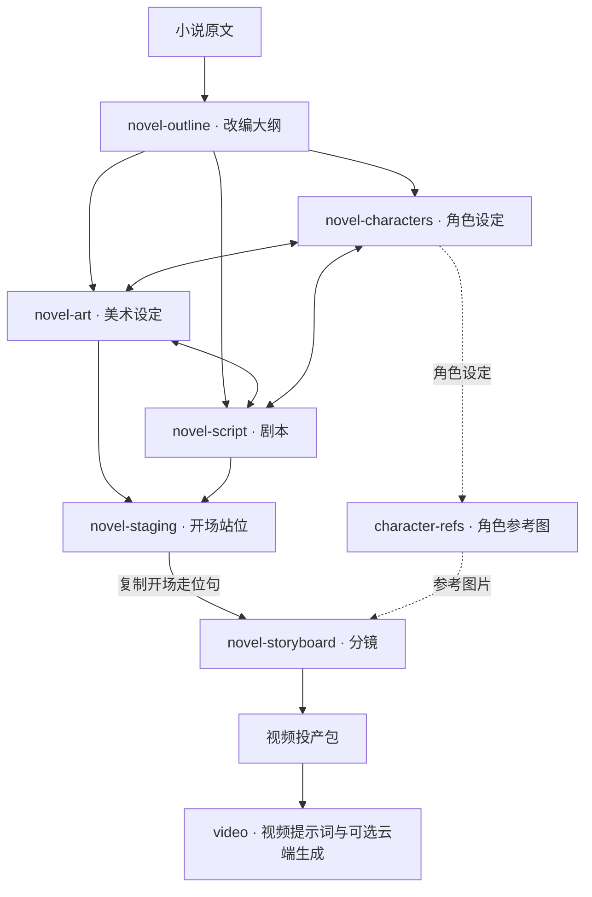

[](README.zh.md)
[](README.md)

# shuohao-skills

**面向各类 Agent 的 AI 短剧制作 skill 集合**：从小说到制作素材——大纲、角色、美术、剧本、开场站位、分镜；另有 Python 智能体把这些阶段串成流水线，并在分镜后提供可选的视频生成阶段。每个 skill 都是自包含目录，任何能够读取 `SKILL.md` 并执行随附脚本的 Agent 都可以使用；Claude Code 和 Codex 只是其中两个运行示例，并非使用前提。

仓库目前有 **7 个 skill：6 个制作阶段，加上可独立使用的角色参考图生成**。改编大纲收敛结构，角色、美术、剧本同步迭代；开场站位在分镜之前确定每场人物的位置。



| Skill | 做什么 |
| --- | --- |
| [**novel-outline**](skills/novel-outline) | 把一本小说改编成短剧大纲五件套：改编说明、人物表、爽点表、分集梗概、资产清单（含叙事道具表）。14 道质量门全部脚本检查，支持已有大纲的体检模式 |
| [**novel-characters**](skills/novel-characters) | 把大纲定下的角色做成角色设定集：人物画像、形象提示词、音色提示词、角色设定图。吃 outline.json 预填角色表，报告语言可选 |
| [**character-refs**](skills/character-refs) | 给任何故事里的角色**真出**参考图（不限小说，自己原创的故事也行）：一段话描述角色，拆字段、补全、确认后先出正面全身锚点，大头照、90° 侧面、背面、细节图都只参考这张锚点，按需分档。每张图带标识、可单独重出，过期自动标出。支持 Qwen Image（ComfyUI）、codex 出图、GPT Image 2 API、自定义命令 |
| [**novel-art**](skills/novel-art) | 给 AI 短剧出美术设定集（场景 + 叙事道具）：一致性锚点、光照与状态变体、尺度参照、无人无手白底提示词。吃 outline.json 预填清单，10 道质量门全部脚本检查 |
| [**novel-script**](skills/novel-script) | 给 AI 短剧写剧本：场次 + 节拍流（动作与台词交替），逐集时长按语速确定性折算，钩子前 3 拍冷开场兑现是门，台词本按角色聚合带音色提示词直接对接 TTS。10 道质量门全部脚本检查 |
| [**novel-staging**](skills/novel-staging) | 给 AI 短剧的每一场排开场站位：先从场景图里认出能站能坐的东西、推算到俯视平面上，再按剧本排谁在哪件东西的哪一侧、坐还是站、面朝哪，程序写出开场走位句交给分镜照抄；报告是能拖动调整的俯视平面，改完导出就是新的 staging.json。8 道质量门全部脚本检查 |
| [**novel-storyboard**](skills/novel-storyboard) | 给 AI 短剧出分镜：段（一次生成 ≤15 秒）→ 分镜（2–5 秒硬门）→ 分镜图（主图钉 0.00 秒、子图钉各自切点），MiniMax H3 提示词的对齐指令与切点时刻逐字对账；分镜图拿设定图当参考图真出图，export 一键出 H3 / Seedance 投产包。18 道质量门全部脚本检查 |

**六个制作阶段的报告都支持中英双语界面**：默认中文，`render --lang en` 出全英文报告（数据内容保持原文）。character-refs 的报告同样内置中英日界面，其他语言现场翻译。

## 开场站位：输入、输出与分镜交接

`novel-staging` 放在剧本之后、分镜之前。必须提供 `script.json`，读取每场的出场人物和剧情；建议同时提供 `art.json`、`outline.json` 和场景图片，分别补充地点设定、人物名称，以及画面中实际存在的桌椅、门窗等。没有场景图片时，可以按美术设定推算，但会标成草稿。输入文件可以来自任何制作方式，不要求安装其他 skill。

| 输出 | 内容 |
| --- | --- |
| `staging.json` | 每场人物开场是否在场、对应物件、方位、位置、坐站、朝向，以及群演人数与位置 |
| `staging.md`（可选） | 按需导出的地点清单、人物站位表和开场走位句 |
| **`staging-report.html`（默认）** | HTML 工具报告：拖动调整俯视站位，检查实时更新，修改后导出 JSON |
| `blocking` 命令输出 | 每场一句开场走位，交给分镜每场第一段使用 |

Agent 负责识别场景图片并安排站位；随附的 Node.js 工具负责预填数据、检查 8 道质量门、渲染报告和生成走位句。默认向用户交付 HTML 工具报告，在本地浏览器打开；JSON 作为工作数据保存，Markdown 仅按需导出。可以从仓库根目录直接体验完整样例：

```bash
node skills/novel-staging/scripts/novel-staging.mjs validate skills/novel-staging/examples/渡口-staging.json --script skills/novel-staging/references/test-fixtures/upstream/渡口-script.json --art skills/novel-staging/references/test-fixtures/upstream/渡口-art.json
node skills/novel-staging/scripts/novel-staging.mjs render skills/novel-staging/examples/渡口-staging.json > staging-report.html
node skills/novel-staging/scripts/novel-staging.mjs blocking skills/novel-staging/examples/渡口-staging.json
```

**分镜目前不会自动读取 `staging.json`。**需要把确认后的开场走位句交给 Agent，要求复制到对应场景第一段的 `blocking`。这一阶段输出站位数据与报告，不生成图片或视频。新建站位方案的完整步骤见 [skill 使用说明](skills/novel-staging)。

## 合成五个阶段的报告

合成器目前支持**大纲、角色、美术、剧本、分镜**，尚未包含站位报告和 character-refs 图册。这五个阶段的报告可以合成一张单页，左侧导航切换——**支持的阶段中，有哪几个就出哪几个面板**：

```bash
node scripts/report.mjs --from <demo目录> --out report.html
```

`--from` 按下面的[工作目录约定](#端到端-demo-工作目录约定)自动发现五份 json；也可以逐个指定（`--outline` `--cast` `--art` `--script` `--storyboard`）。只跑了角色那一段就只有一个面板，不报错。

它是**组装器，不是独立 skill**：不 import 任何 skill 的代码，而是调各自的 `render --html` 拿产物再拼装。所以五个 skill 一行不改、各自仍然独立可跑、可以单独拷走；某个 skill 改了渲染，这边自动跟上。

合并时处理三件事——**这三件都在组装器里做，不侵入 skill**：

- **样式串味**。五份报告共用 57 个类名，其中 13 个同名不同定义（`.copy` `.kpis` `.badge` `.chip`……），所以给每份样式的每条选择器加作用域前缀
- **脚本串味**。各报告的脚本都是 `document.querySelector('.expo')` 这种全局查询，合成一页后只会命中第一个——五个导出按钮会全废。做法是给每份脚本套一层作用域代理
- **图片路径**。各报告的图相对自己那份 json 的目录（`images/…`、`E01-01/f1.png`），合成后按输出文件的位置重算

默认一次显示一个面板（五份加起来将近六十万字符）。左下角「平铺全部」把所有面板同时展开，Cmd+F 恢复全局搜索。数字键 `1`–`5` 切面板，`#pane-script` 这样的深链可以直接分享到某一屏。

```bash
node scripts/report-selftest.mjs   # 92 项断言，不起浏览器
```

六个制作阶段的报告预览：

**novel-outline · 短剧改编大纲**


**novel-characters · 角色设定集**


**novel-art · 美术设定集（场景 + 道具，设定图为 skill 实际生成）**


**novel-script · 剧本（时长仪表 + 分集剧本 + 台词本）**


**novel-staging · 开场站位（俯视平面能拖动调整，改完导出）**


**novel-storyboard · 分镜（分镜节奏带 + 主/子分镜图为 skill 实际生成 + H3 提示词）**


不从小说出发也行，给任何一个角色真出参考图：

**character-refs · 角色参考图（锚点 GPT 出、其余 Qwen 出，全部为 skill 实际生成）**


## 安装

```bash
git clone https://github.com/eternityspring/shuohao-skills.git
cd shuohao-skills
./scripts/install.sh
```

安装脚本目前会检测 Claude Code 和 Codex，并为它们创建**软链接**——`git pull` 之后立刻生效，不需要重新安装。Skill 本身不依赖这两个运行时；其他 Agent 可以把对应 skill 目录复制或链接到自己的 skill 目录，也可以直接加载其中的 `SKILL.md`。

```bash
./scripts/install.sh novel-characters   # 只安装某一个
./scripts/install.sh --codex            # 只安装到 codex
./scripts/install.sh --uninstall        # 取消软链
```

也可以手动创建软链接：

```bash
AGENT_SKILLS_DIR=/path/to/your-agent/skills
ln -s "$PWD/skills/novel-characters" "$AGENT_SKILLS_DIR/novel-characters"
ln -s "$PWD/skills/novel-characters" ~/.claude/skills/novel-characters
ln -s "$PWD/skills/novel-characters" ~/.codex/skills/novel-characters
```

## 不使用 Codex：Python 智能体（zhipu_agent）

没有 Codex 或 Claude Code 额度时，可以使用仓库里的 `zhipu_agent/`：Python 加任意 OpenAI 兼容的大模型接口（智谱官方或聚合平台），按顺序驱动这七个技能包。技能包本身没有改动：模型读取各技能的 `references/*-pass.md` 和 `schema.md` 当作指令，技能自带的 Node 脚本（`validate`、`merge`、`assemble`、`render` 等）当作质量门。校验不过时，报错会按集号、场景名、角色名对到具体条目，只让出错的条目带着报错回炉。

> 状态：离线测试（模拟模型加真实校验器）已跑通《渡口》样例的六个阶段。真实模型的写作质量、回炉几轮能过、视觉模型的图片格式、真实出图都还没有验证，第一次运行请先使用短文本和 `--eps` 小范围试跑。

### 安装与配置

```bash
git clone -b master https://github.com/andnls100/shuohao-python-agen.git
cd shuohao-python-agen
pip install -r requirements.txt        # 只需要 openai 包
node --version                         # 需要 Node 18 及以上
copy models.example.json models.json   # Windows；Linux/macOS 可用 cp
```

**模型 API 配置统一使用 `models.json` 号池**，不需要把模型地址、模型名和 API Key 配置在 `.env`。在 `models.json` 的 `text` 列表中配置文本模型，在 `vision` 列表中按需配置视觉模型；视频生成 API 则配置在可选的 `video` 列表。每项分别填写自己的平台地址、模型名和 Key，也可以用 `api_key_env` 从系统环境变量读取 Key。真实的 `models.json` 已被 `.gitignore` 忽略，不会提交。

### 多模型与备用平台（号池）

- `strategy: "failover"`（默认）：按列表顺序调用，前一个平台失败后自动切换下一个备用平台。
- `strategy: "round_robin"`：文本和视觉模型调用按轮询分摊到不同平台。
- `text` 用于文字生成，`vision` 用于 staging 阶段的场景图识别；不需要视觉模型时可写 `[]`。
- 每项必填 `name`、`base_url`、`model` 和 `api_key` 或 `api_key_env`。每个模型可独立配置 `temperature`、`max_tokens`、`timeout`、`stream`、`json_mode`。
- 平台出错时会先有限重试，再切换备用项；冷却时间与鉴权/欠费错误的处理规则见配置代码。
- `.env` 仅用于并发、回炉轮数等运行参数；若使用 `api_key_env`，密钥需提前设置为相应的系统环境变量。
- `python run_agent.py doctor --ping` 会逐个测试配置的文本和视觉模型。

视频生成号池格式、故障转移和任务续查规则见 [视频生成说明](docs/video-generation.md)。

### 运行

统一入口是根目录的 `run_agent.py`（等价于 `python -m zhipu_agent.main`；部分机器的 Python 被设成隔离模式，`-m` 会找不到包，这时就使用 `run_agent.py`）：

```bash
python run_agent.py doctor --ping      # 检查环境，并真的调用一次模型
python run_agent.py run --book input/novel.txt --episodes 6 --minutes 2 --genre 都市
python run_agent.py status             # 各阶段产物是否存在、是否通过校验
```

小说文本放在 `input/novel.txt`，UTF-8 或 GBK 都可以。产物都在 `output/`，每个阶段有一份 `*-report.html`。

### 流水线

| 阶段 | 命令里的名字 | 对应技能 |
| --- | --- | --- |
| 1 | `outline` | novel-outline：先出骨架，暂停等你确认，再分批写每集 |
| 2 | `characters` | novel-characters：扫描、归并、逐个角色出卡 |
| 3 | `art` | novel-art：场景和叙事道具 |
| 4 | `script` | novel-script：三集一批 |
| 5 | `staging` | novel-staging：先出地点平面，再按地点写场景 |
| 6 | `storyboard` | novel-storyboard：三集一批，最后导出投产包 |
| 7 | `refs` | character-refs：可选，默认不跑；可生成角色参考图 |
| 8 | `video` | 视频阶段：读取分镜，生成逐段提示词、任务清单和人工质检清单；配置 API 并显式指定 `--video-submit` 后才会调用云端生成 |

不加 `--stages`（或使用 `--stages all`）时只跑前六个制作阶段；`refs` 和 `video` 都需显式指定。视频阶段依赖已经生成的 `storyboard`。已经完成并通过校验的阶段会被跳过；视频阶段可以通过 `--eps` 按集执行。

### 各步骤的输出文件

产物都在 `--out` 指定的目录里（默认 `output/`），每个阶段一个子目录。下面的 `<书名>` 是从小说里的《……》或文件名推断出来的。**每个阶段的主文件是 `.json`**，后面的阶段读取的就是它；`.md` 和 `.html` 是从它渲染出来的，方便阅读。

| 步骤 | 阶段 | 主文件 | 供阅读的文件 | 中间文件（缓存，续跑时读取） |
| --- | --- | --- | --- | --- |
| 1 | `outline` | `outline/<书名>-outline.json`：改编说明、人物表、爽点表、分集梗概、资产清单 | `<书名>-outline.md`、`outline-report.html` | `work/outline/eps-*.json`（分批写的每集梗概） |
| 2 | `characters` | `characters/<书名>-cast.json`：每个角色的人物画像、形象提示词、音色提示词 | `<书名>-cast.md`、`report.html` | `work/characters/`：`seed.json`（大纲预填的角色清单）、`merged.json`（归并结果）、`card-<角色名>.json`（每个角色的卡）、`summary.txt`（故事摘要） |
| 3 | `art` | `art/<书名>-art.json`：场景设定和叙事道具的设定集，含无人无手的白底提示词 | `<书名>-art.md`、`art-report.html` | `work/art/scene-S01.json`、`prop-P01.json`（每个场景、每件道具一个） |
| 4 | `script` | `script/<书名>-script.json`：分集剧本，场次加节拍，含台词本 | `<书名>-script.md`、`script-report.html` | `work/script/ep-001.json`（每集一个）、`script-batch.json` |
| 5 | `staging` | `staging/staging.json`：每个地点能站能坐的东西，以及每场的开场站位 | `blocking.txt`（每场一句开场走位句，分镜照抄）、`staging-report.html`（可拖动调整的俯视平面） | `work/staging/location-S01.json`（认图结果）、`scenes-*.json` |
| 6 | `storyboard` | `storyboard/<书名>-storyboard.json`：段、分镜、分镜图提示词、H3 提示词 | `<书名>-storyboard.md`、`storyboard-report.html` | `storyboard/.gates.jsonl`（质量门失败的累积记录） |
| 7 | `refs`（可选） | `character-refs/<角色名>/asset.json`：角色描述加每张参考图的全部版本 | 配了出图模型并加 `--refs-gen` 时，另有 `character-refs/character-refs.html` | `work/refs/<角色名>-intake.json`（模型整理出的角色描述） |
| 8 | `video`（可选） | `video/video-manifest.json`：逐段提示词、时长、任务 ID、生成状态、视频 URL 和本地路径 | `video/prompts/<分段ID>.txt`、`video/qc-checklist.md`；下载成功的视频保存在 `video/videos/<分段ID>.mp4` | `video-manifest.json` 保存云端任务状态，重新执行可复用已保存的任务 ID 和已完成结果 |

第 6 步还会在 `storyboard/` 下导出投产包：
- `storyboard/E01-01/prompt.md`、`E01-02/prompt.md`……每一段一个文件夹，里面是这一段的 H3 提示词，以及按 Picture 序号列出的分镜图挂载说明。
- `storyboard/manifest.json`：每一段的时长、切点、提示词路径、分镜图路径，以及缺失的分镜图清单。
- **分镜图（`f1.png`、`f2.png`……）本流水线不会产生**，需要你使用出图工具按分镜图提示词另行生成，放进对应的段文件夹，再重新导出。

其他文件：
- `source/`：转成 UTF-8 的小说原文副本。
- `agent.log`：运行日志。
- `work/`：所有缓存。中断后重跑会读它接着做；想让某一项重做，删掉对应的缓存文件，或者加 `--force`。

第 7 步配置了出图模型并加 `--refs-gen` 时，每个角色目录下还有 `default/front-full.v1.png`（锚点）、`face-front.v1.png` 等参考图；没有配置时只生成 `asset.json`，不出图。

### 常用命令

```bash
# 只跑大纲（outline 必须给出总集数、单集分钟数、题材；题材是自由文本，写法见下面的「题材怎么填」）
python run_agent.py run --stages outline --book input/novel.txt --episodes 6 --minutes 2 --genre 都市

# 大纲通过后，一次跑角色和美术
python run_agent.py run --stages characters,art

# 只处理前两集的剧本、站位、分镜（先小范围试跑，省额度）
python run_agent.py run --stages script,staging,storyboard --eps 1-2

# 竖屏分镜、中文提示词
python run_agent.py run --stages storyboard --aspect 9:16 --prompt-lang zh

# 角色参考图：只建档案；加 --refs-gen 才真的出图（需先配置出图模型）
python run_agent.py run --stages refs --refs-names 沈知微 --refs-look 动漫

# 不暂停，骨架自动确认
python run_agent.py run --yes ...

# 视频阶段：先生成提示词和任务清单，不调用云端 API
python run_agent.py run --stages video --eps 1

# Seedance 风格提示词（仍然只是预览）
python run_agent.py run --stages video --eps 1 --video-protocol seedance

# 确认 API 配置、价格和提示词后，显式提交视频生成任务
python run_agent.py run --stages video --eps 1 --video-submit

# 忽略已有产物和缓存，全部重做
python run_agent.py run --stages script --force
```

主要参数：

| 参数 | 说明 |
| --- | --- |
| `--book` | 小说文本，默认 `input/novel.txt` |
| `--out` | 输出目录，默认 `output` |
| `--stages` | 阶段，逗号分隔，默认前六个 |
| `--episodes` `--minutes` `--genre` | outline 阶段必填：总集数、单集分钟数、题材（自由文本，见下） |
| `--adapt-mode` | 改编幅度：忠实、抽核、借壳，默认抽核 |
| `--eps` | 只处理这些集，如 `1-3` 或 `1,3,5` |
| `--aspect` | 分镜画幅 `16:9` 或 `9:16` |
| `--prompt-lang` | H3 提示词语言 `en` 或 `zh`，默认 `en` |
| `--images` | 场景设定图目录（staging 认图，需要视觉模型） |
| `--refs-names` `--refs-look` `--refs-gen` | refs 阶段要处理的角色、画风，以及是否真正调用出图模型 |
| `--video-protocol` | 视频提示词协议：`h3`（默认，沿用分镜中的 H3 提示词）或 `seedance`（根据结构化分镜字段拼接提示词） |
| `--video-submit` | 明确授权调用配置好的视频 API；不加此参数只生成预览文件 |
| `--yes` | 不暂停，骨架拍板点自动确认 |
| `--force` | 忽略已有产物和缓存 |
| `--concurrency` `--fix-rounds` | 同时进行的调用数（默认 3）、最多回炉几轮（默认 1） |

**分镜修复采用局部优先策略**：像 5.1 秒这种仅超上限 0.1 秒的轻微时长问题，会先自动改到上限并重算 H3 对齐时间；仍有明确 `段号#镜号` 的错误时，只把该镜的 cut 和对应 H3 镜头正文交给模型修复（每个镜头最多一次，单批最多 6 个）。不会因为单镜违规而让模型重写整集；无法定位到具体镜头或修复后仍不通过时，保存批次 JSON 并停止，供人工检查。其他阶段的默认自动回炉轮数为 1，可通过 `--fix-rounds` 或 `.env` 中的 `AGENT_FIX_ROUNDS` 调整。

### 视频生成阶段（可选）

视频阶段接在 storyboard 之后，**不会在普通流水线中自动运行**。默认只生成提示词与清单，不会发起云端任务。

```bash
# 沿用分镜的 h3Prompt
python run_agent.py run --stages video --eps 1

# 根据结构化镜头字段生成 Seedance 风格提示词
python run_agent.py run --stages video --eps 1 --video-protocol seedance
```

输出到 `output/video/`：

- `video-manifest.json`：每段提示词、时长、任务 ID、状态、视频 URL 和本地路径。
- `prompts/<分段ID>.txt`：可单独检查、修改的提示词。
- `qc-checklist.md`：角色连续性、站位、台词、画面瑕疵和剪辑点的人工质检清单。
- `videos/<分段ID>.mp4`：API 返回下载链接且下载成功时保存。

在项目根目录的 `.env` 配置供应商的实际接口：

```dotenv
VIDEO_API_SUBMIT_URL=https://your-provider.example/v1/videos/generations
VIDEO_API_STATUS_URL_TEMPLATE=https://your-provider.example/v1/videos/{task_id}
VIDEO_API_KEY=your_api_key
VIDEO_API_MODEL=your-video-model
VIDEO_API_TIMEOUT=120
VIDEO_API_POLL_INTERVAL=5
VIDEO_API_MAX_WAIT=900
```

当前适配器使用通用 REST 约定：Bearer Token 鉴权，提交 JSON 字段为 `model`、`prompt`、`duration`、`aspect_ratio`。平台若使用不同请求字段、鉴权或响应格式，需要按官方文档调整 `zhipu_agent/stages/video.py`。**OpenAI 兼容文本 API 不代表一定支持视频生成。**

确认平台文档、模型、费用和提示词后，才显式提交：

```bash
python run_agent.py run --stages video --eps 1 --video-submit
```

`--eps` 支持 `1-3` 或 `1,3,5`。失败会写入 manifest；配置状态 URL 后可轮询异步任务，已完成分段会跳过。下载失败会保留云端 URL 和错误信息。当前阶段**不会自动把所有片段拼接成整集 MP4**。详见 [视频生成阶段文档](docs/video-generation.md)。

### 题材怎么填

`--genre` **没有固定的可选列表**，技能包只要求它不能缺。题材的作用是决定爽点类型：模型会按它来设计打脸、揭破、反转等爽点和钩子，所以写得越具体越准，填错会让整份大纲偏掉。

仓库里出现过的写法可以参考：

| 写法 | 出处 |
| --- | --- |
| `民国情感悬疑` | `skills/novel-outline/examples/渡口-outline.json` 的样例 |
| `女频逆袭` | `skills/novel-outline/references/schema.md` 里的数据结构示例 |
| `都市` | 上面命令里的示例 |

建议写成「受众或背景加核心看点」，比如 `都市医疗逆袭`、`古代宫斗`、`悬疑推理`。以上只是写法示例，不是技能包规定的枚举。

### 中断、续跑和排错

- 每个条目的结果缓存在 `output/work/`，中断后重新运行同一条命令会接着做。
- 调用模型时终端会打印 `[llm]` 进度行：每次调用、每隔约 15 秒的生成进度、重试原因。长时间没有进度行，先检查接口地址和网络（国内访问海外接口需要代理）。
- 默认使用流式调用。平台不支持流式时，在 `.env` 里设置 `ZHIPU_STREAM=0`。
- 阶段回炉次数用完仍未通过，程序会停下并列出违规项，文件保留在 `output/`，手工修改后重跑即可。
- 其他可选配置见 `.env.example`；更详细的设计说明见 [`zhipu_agent/README.md`](zhipu_agent/README.md)。

## 前置条件

| | 必需？ | 说明 |
| --- | --- | --- |
| **Node** | 必需 | ≥ 18。skill 的脚本只用标准库，**没有 npm 依赖，不需要 install** |
| **模型额度** | 必需 | 用你当前会话的额度，**不需要任何 API key** |
| **Agent 运行时** | 必需 | 能够读取 `SKILL.md` 并执行随附的 Node.js 脚本。Claude Code、Codex 以及其他兼容 Agent 均可 |
| **出图模型** | 只有 character-refs 需要 | 四选一：自己的 ComfyUI（Qwen Image）、本机 codex 内置出图（吃 ChatGPT 订阅额度）、OpenAI API key（GPT Image 2）、自定义命令。第一次使用时选 |

## 仓库约定

每个 skill 一个目录，**自包含、可以单独拷走**：

```
skills/<skill-name>/
├── SKILL.md          给 agent 读的工作流（必需）
├── README.md         给人读的说明
├── scripts/
│   ├── <name>.mjs    确定性工具，零依赖
│   └── selftest.mjs  自测，不调模型（必需）
├── references/       按需加载的详细指令
├── examples/         自带样例，同时当测试夹具
└── assets/           截图
```

两条硬要求：

- 每个 skill 必须有 `SKILL.md`
- 每个 skill 必须有 `scripts/selftest.mjs`，**不调用模型、不花额度**，覆盖全部确定性逻辑

加新 skill 之前，先把全部自测跑一遍：

```bash
for f in skills/*/scripts/selftest.mjs; do node "$f"; done
```

没有配 CI——自测足够快（1 秒），本地跑一次比等 CI 更省事。**只在 macOS + Node 24 上验过**；代码没有平台相关调用，Linux 和更低版本 Node 理论上没问题，但没验。

## 端到端 demo 工作目录约定

把一本小说完成六个制作阶段（大纲 → 角色／美术／剧本迭代 → 开场站位 → 分镜），会产出大量 `*.json` / `*.md` / `*-report.html`。**不要平铺在根目录**，按六个 skill 各建一个目录归档：

```
<demo>/
├── outline/       ← novel-outline 产出：<剧>-outline.json / .md / -report.html
├── characters/    ← novel-characters 产出：<剧>-cast.json / .md / -report.html
├── art/           ← novel-art 产出：<剧>-art.json / .md / -report.html
├── script/        ← novel-script 产出：<剧>-script.json / .md / -report.html
├── staging/       ← novel-staging 产出：staging-report.html（主交付）+ staging.json；Markdown 按需导出
├── storyboard/    ← novel-storyboard 产出：<剧>-storyboard.json / .md / -report.html
│   ├── manifest.json  ← export 产出
│   ├── E01-01/        ← export 的分镜投产包，每段一个文件夹（prompt.md + f1..fN.png）
│   ├── E01-02/
│   └── …
├── docs/          ← 自己写的使用说明、PR 草稿等（与机器产物解耦）
└── scripts/       ← 跑管线的辅助脚本（探索期脚本用 _ 前缀保留溯源）
```

约定要点：

- **每个 skill 一个目录**，存放它自己的 `json` / `md` / `html` 三件套，加新角色/场景只往对应目录放，不污染根目录
- **分镜的 `manifest.json` 与 `E01-0x/` 投产包一起归 `storyboard/`**，就是 `export --out storyboard` 的原样产出。**段文件夹不要再往下收一层**（例如收进 `segments/`）：分镜报告里的图走相对路径 `<段号>/f<切序>.png`，默认要求报告 html 与段文件夹同级（放在别处就用 `render --frames <目录>` 指过去），多套一层目录又不指，报告里的图会**静默**全变成「未生成」占位——实测把 10 个段文件夹移进 `segments/` 之后，内嵌图从 2 张变 0 张，报告不会报错
- **报告 HTML 与生成的图/视频可由 `render` 重跑再生**——进版本控制时建议只提交 `json` / `md` / `docs` / `scripts`，报告 HTML 和分镜 `png` 用 `.gitignore` 排除，保持仓库轻量
- 用法类文档（如各报告的使用说明）放 `docs/`，与 skill 自动生成的产物分开，方便单独维护

> 这套结构来自《渡口》端到端 demo 的实际归档经验，demo 的工作目录在本仓库之外，这里只固化约定。

## Star 趋势

[](https://star-history.com/#eternityspring/shuohao-skills&Date)

## License

[Apache 2.0](LICENSE)

